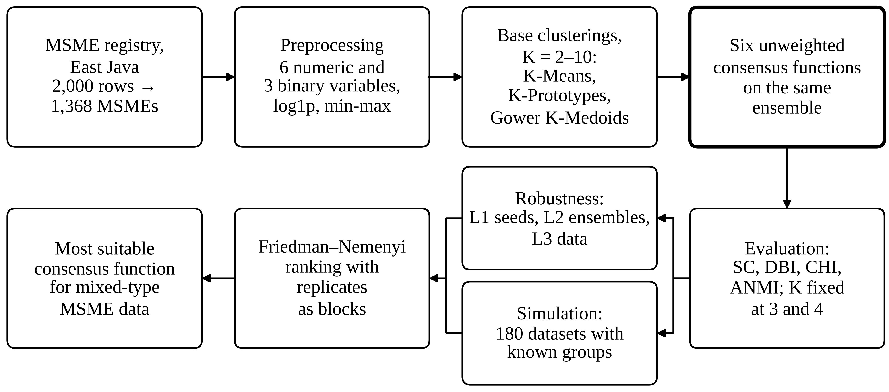
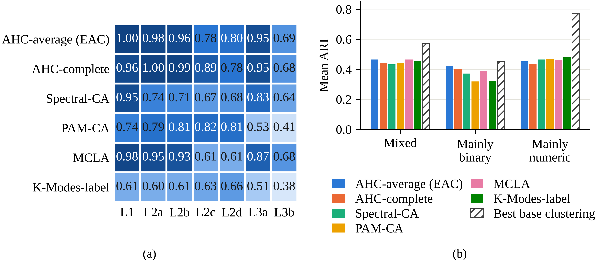

# Evidence Accumulation Clustering for Mixed-Type MSME Data: A Comparison of Unweighted Consensus Functions

Code, semi-synthetic data, aggregate results and figures for the paper
**"Evidence Accumulation Clustering for Mixed-Type MSME Data: A Comparison of Unweighted Consensus Functions"**,
submitted to *JUTI: Jurnal Ilmiah Teknologi Informasi* (under review).

The study asks which consensus function suits mixed-type registry data when all base clusterings are treated
equally (no weighting). It combines three base clusterings (K-Means, K-Prototypes and K-Medoids on Gower distance)
and compares six unweighted consensus functions on the same ensemble:

| Consensus function | Input |
|---|---|
| AHC-average (evidence accumulation clustering, EAC) | co-association matrix *C* |
| AHC-complete | co-association matrix *C* |
| Spectral-CA | co-association matrix *C* as affinity |
| PAM-CA (K-Medoids) | dissimilarity 1 − *C* |
| MCLA | hypergraph of base-cluster labels (METIS) |
| K-Modes-label | base-cluster labels as categorical data |



## What the notebook does

| Section | Content |
|---|---|
| 0A, 0B, 0 | Setup (Colab or local), checkpoints, data loading, configuration |
| 1 | Pre-processing: 2,000 rows → 1,368 unique MSMEs; 6 numeric + 3 binary variables; median/mode imputation; log1p on turnover, production cost and wages; Min-Max scaling |
| 2 | Gower distance and 10-dimensional classical MDS projection |
| 3–4 | Three base clusterings (seed 42) and six consensus functions for K = 2–10 |
| 4–5 | Evaluation: Silhouette (Gower), Davies–Bouldin and Calinski–Harabasz (MDS space), ANMI, Euclidean silhouette (sensitivity), cluster sizes; K fixed at 3 and 4 |
| 6 | Robustness layer 1: random initialisation (30 seeds) |
| 7 | Robustness layer 2: ensemble generation (33 partitions, 4 perturbation schemes, 30 seeds) |
| 8 | Robustness layer 3: data perturbation (80% subsampling, 5% binary noise, 30 replicates) |
| 9 | Friedman test with Nemenyi post-hoc (replicates as blocks, *q* = 2.850 for six functions) |
| 10 | Semi-synthetic simulation: 180 datasets with known groups (external validation by ARI) |
| 10B | Export of the 180 semi-synthetic datasets (CSV in ZIP) and re-test of six of them |
| 11 | Excel workbook with all tables |



## Repository structure

```
.
├── Notebook_Perbandingan_Fungsi_Konsensus_UMKM.ipynb   # full analysis (comments in Indonesian), with outputs
├── data/
│   └── semi_synthetic/
│       └── Dataset_Semi_Sintetis_180.zip               # 180 CSV files + daftar_dataset.csv + README.txt
├── results/
│   └── aggregate_results.xlsx                          # all aggregate tables (no record-level sheets)
├── images/
│   ├── fig1_framework.png
│   └── fig2_robustness_and_simulation.png
├── requirements.txt
├── CITATION.cff
├── LICENSE
└── README.md
```

## Data availability

The MSME registry analysed in this study was provided by the **East Java Provincial Office of Cooperatives and
SMEs (Dinas Koperasi dan UKM Provinsi Jawa Timur)**. It contains confidential business records and **cannot be
shared publicly**, so it is not included in this repository; the raw spreadsheet is excluded through
`.gitignore`. Researchers may request access from the corresponding author, subject to permission from the office.

`results/aggregate_results.xlsx` contains only aggregate tables. The three record-level sheets produced by the
notebook (cleaned data, scaled data and cluster labels per MSME) have been removed.

The **180 semi-synthetic datasets** in `data/semi_synthetic/` contain no real records. They were generated with a
Gaussian copula that reproduces the marginal distributions of the nine variables and the turnover–production cost
correlation, with planted groups of known size. See `README.txt` inside the ZIP for the generator, the separation
settings and the seed formula. Sections 10 and 10B of the notebook regenerate every file exactly.

## How to run

### Option A: Google Colab

1. Open the notebook in Colab.
2. Run all cells. The first cell installs any missing packages and mounts Google Drive; the working folder is
   `MyDrive/UMKM_Fungsi_Konsensus`.
3. When asked, upload `dataset_umkmjatim_full2000.xlsx` (only needed once; a copy is kept in Drive).

### Option B: Local (Jupyter)

```bash
python -m venv .venv
# Windows PowerShell:  .venv\Scripts\Activate.ps1
# macOS / Linux:       source .venv/bin/activate
pip install -r requirements.txt
```

Place the data file at `UMKM_Fungsi_Konsensus/dataset_umkmjatim_full2000.xlsx` (next to the notebook), or point to
another folder with the environment variable `UMKM_BASE_DIR`, then open the notebook with Jupyter and run all cells.

The full run took about 26 minutes on 2 CPU cores. Intermediate results are cached in `checkpoint_konsensus/`; set
`RESET_CHECKPOINT = True` to recompute everything, and `N_JOBS` to control parallel processes.

Results are written to `UMKM_Fungsi_Konsensus/hasil_konsensus/`. That folder is git-ignored because the full
workbook contains record-level sheets.

### Key settings

| Setting | Value |
|---|---|
| Random seed | `RANDOM_STATE = 42` |
| Number of clusters | K = 2–10 evaluated; K = 3 and 4 fixed for comparison; profiles at K = 4 |
| Replicates per robustness layer | `N_REP = 30` |
| Ensemble for layer 2 | 33 partitions, 4 perturbation schemes |
| Semi-synthetic simulation | 3 separation sources × 3 levels × K ∈ {3, 4} × 10 replicates = 180 datasets, n = 1,368 each |
| Nemenyi critical value | *q*₀.₀₅ = 2.850 (k = 6) |

## License

- **Code** (notebook): MIT License, see [`LICENSE`](LICENSE).
- **Semi-synthetic datasets, aggregate results and figures**: [CC BY 4.0](https://creativecommons.org/licenses/by/4.0/).
- **Paper text** follows the license of the journal once published.


## Contact

Mohammad Naufal Fahmi, Department of Information Systems, Universitas Trunojoyo Madura.
Email: naufal.fahmi0423@gmail.com
